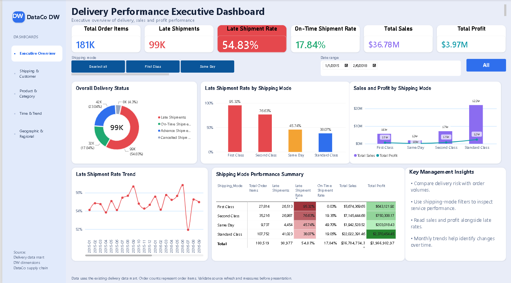
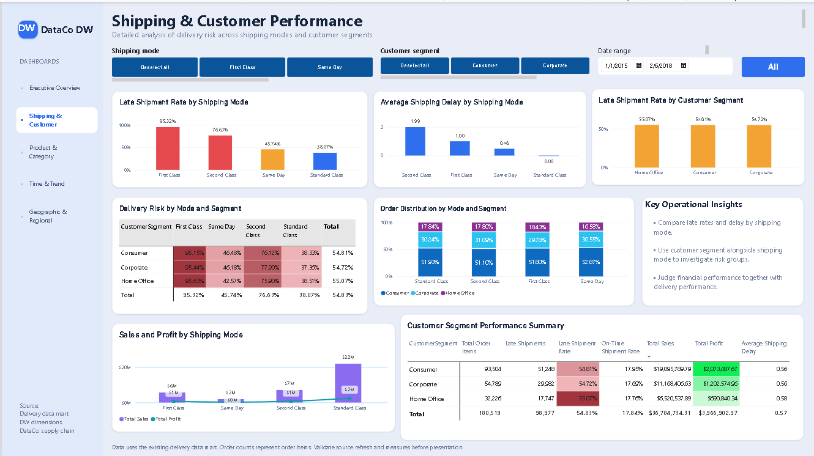
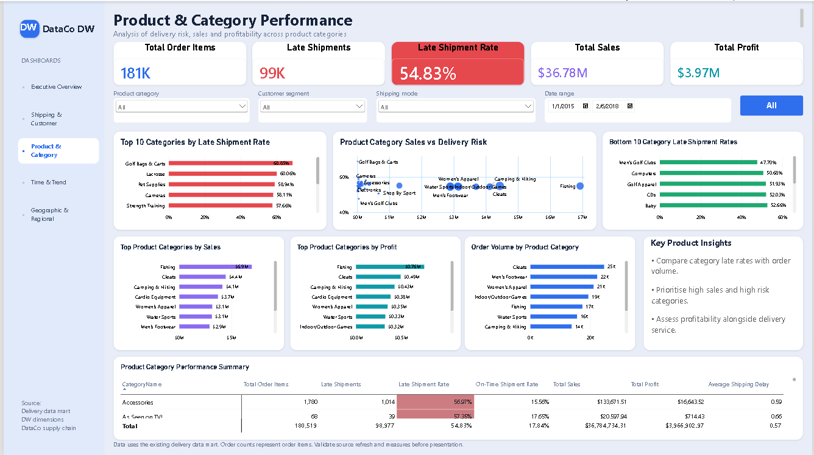
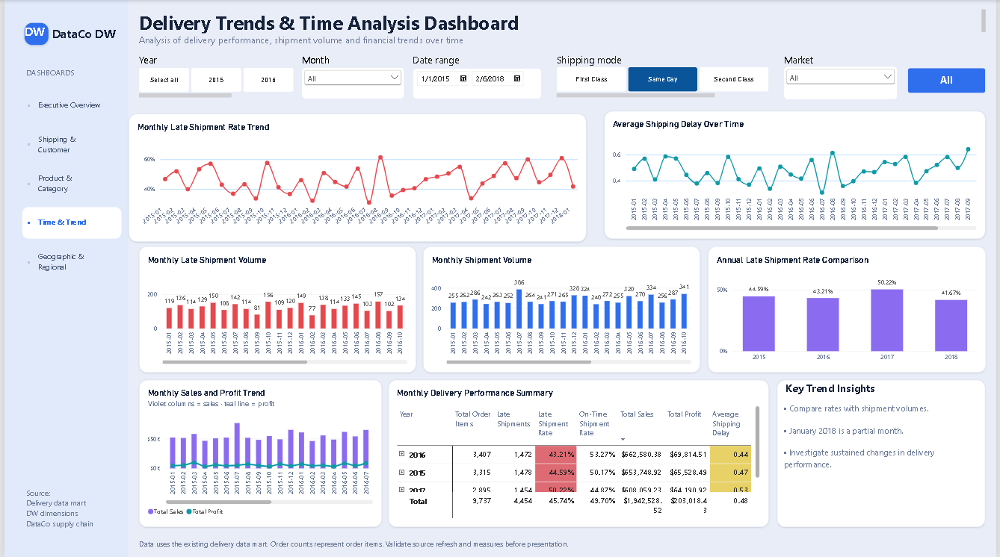
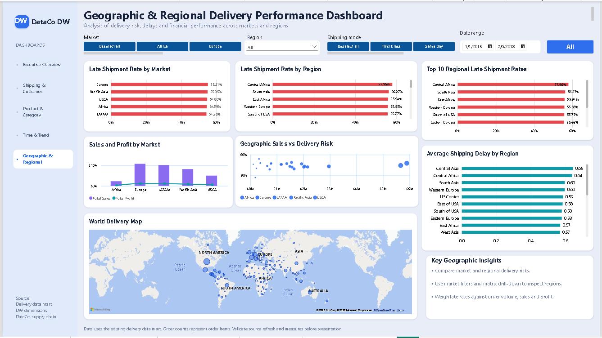

# DataCo Supply Chain — Data Warehouse and Business Intelligence Project

> **SLIIT | IT3101 — Data Warehousing and Business Intelligence (Year 3, Semester 1, 2026)**

A complete Data Warehouse and Business Intelligence (DWBI) solution built using the **DataCo Smart Supply Chain for Big Data Analysis** dataset, featuring a SQL Server staging layer, star-schema Data Warehouse, delivery-performance Data Mart, OLAP analysis, and interactive Power BI dashboards.

---

## Table of Contents

- [1. Project Overview](#1-project-overview)
- [2. Project Objectives](#2-project-objectives)
- [3. Technologies Used](#3-technologies-used)
- [4. Repository Structure](#4-repository-structure)
- [5. Project Architecture](#5-project-architecture)
- [6. Data Warehouse Design](#6-data-warehouse-design)
- [7. Data Mart](#7-data-mart)
- [8. Power BI Dashboards](#8-power-bi-dashboards)
- [9. Key Project Results](#9-key-project-results)
- [10. Team Members & Responsibilities](#10-team-members--responsibilities)
- [11. Project Conclusion](#11-project-conclusion)
- [12. Academic Information](#12-academic-information)

---

## 1. Project Overview

This group project was developed for the **IT3101 — Data Warehousing and Business Intelligence** module at the **Sri Lanka Institute of Information Technology (SLIIT)**.

The project focuses on designing and implementing an end-to-end Data Warehouse and Business Intelligence solution using the **DataCo SMART SUPPLY CHAIN FOR BIG DATA ANALYSIS** dataset. Its primary objective is to transform transactional supply-chain data into actionable business insights for analysing:

- Order volume, sales, and profit
- Shipping performance and delivery outcomes
- Customer segments and product categories
- Temporal trends and geographical patterns

The solution integrates a staging layer, a dimensional Data Warehouse (`DataCoDW`), a delivery-performance Data Mart, SQL-based OLAP analysis, and a five-page interactive Power BI dashboard suite.

---

## 2. Project Objectives

- Create a staging layer (`dbo.Stg_DataCoSupplyChain`) for importing the source dataset.
- Perform data preparation, data profiling, and relationship validation.
- Design a Data Warehouse using dimensional modelling principles.
- Implement customer, product, date, location, and shipping dimensions.
- Develop an order-item fact table (`DW.FactOrderItem`).
- Implement ETL processes using Microsoft SQL Server.
- Create a delivery-performance Data Mart (`DM.FactDeliveryPerformance`).
- Perform OLAP queries for multidimensional business analysis.
- Develop interactive Power BI dashboards with KPIs, drill-downs, and slicers.
- Identify key business insights and provide practical recommendations.

---

## 3. Technologies Used

| Category | Technology / Tool |
| :--- | :--- |
| **Database Engine** | Microsoft SQL Server |
| **Database Management** | SQL Server Management Studio (SSMS) |
| **Query & ETL Language** | T-SQL (SQL) |
| **Business Intelligence & Visualization** | Power BI Desktop |

---

## 4. Repository Structure

```text
DataCo-Supply-Chain-DWB/
├── DataSet/
│   └── DataCoSupplyChainDataset.csv        # Source supply-chain dataset
├── PowerBI/
│   └── DataCo_Dashboards_final.pbix        # Interactive Power BI report file
├── Report/
│   └── 2026-DS-65.pdf                      # Final project report
├── Screenshots/
│   ├── Executive_Overview.png              # Dashboard Page 1
│   ├── Shipping_Customer.png               # Dashboard Page 2
│   ├── Product_Category.png                # Dashboard Page 3
│   ├── Time_Trends.png                     # Dashboard Page 4
│   └── Geographic_Analysis.png             # Dashboard Page 5
├── SQL/
│   └── final_project.sql                   # Staging, profiling, DW/DM DDL, ETL & OLAP queries
└── README.md                               # Project documentation
```

---

## 5. Project Architecture

The solution follows a layered Data Warehouse and Business Intelligence architecture inside database `DataCoDW`:

| Layer | Description | Implementation |
| :--- | :--- | :--- |
| **1. Source Layer** | Raw transactional DataCo supply-chain dataset | [`DataSet/DataCoSupplyChainDataset.csv`](DataSet/DataCoSupplyChainDataset.csv) |
| **2. Staging Layer** | Source data imported into SQL Server for profiling & validation | `dbo.Stg_DataCoSupplyChain` |
| **3. Data Warehouse Layer** | Cleansed dimension and fact tables in a star schema | `DW` schema ([`SQL/final_project.sql`](SQL/final_project.sql)) |
| **4. Data Mart Layer** | Aggregated delivery-performance metrics for reporting | `DM.FactDeliveryPerformance` |
| **5. Business Intelligence Layer** | Interactive dashboards, KPIs, and visual analytics | [`PowerBI/DataCo_Dashboards_final.pbix`](PowerBI/DataCo_Dashboards_final.pbix) |

---

## 6. Data Warehouse Design

The Data Warehouse (`DW` schema) is modelled using a **Star Schema** centered around an order-item grain fact table.

### Dimension Tables

| Table | Primary Key | Description |
| :--- | :--- | :--- |
| `DW.DimCustomer` | `CustomerKey` | Customer identifiers, names, segments, and address attributes |
| `DW.DimProduct` | `ProductKey` | Product identifiers, names, prices, status, category, and department |
| `DW.DimDate` | `DateKey` | Calendar attributes (`FullDate`, `Year`, `Quarter`, `Month`, `WeekOfYear`, `DayOfMonth`, `DayName`) |
| `DW.DimLocation` | `LocationKey` | Market, region, country, state, city, zipcode, latitude, and longitude |
| `DW.DimShipping` | `ShippingKey` | Shipping mode, delivery status, and late delivery risk flag |

### Fact Table

- **`DW.FactOrderItem`** (`OrderItemFactKey`)
  - **Grain:** One record per order item (`Order_Item_Id`, `Order_Id`).
  - **Foreign Keys:** `CustomerKey`, `ProductKey`, `OrderDateKey`, `ShippingDateKey`, `LocationKey`, `ShippingKey`.
  - **Measures:** `Quantity`, `Sales`, `Discount`, `OrderItemTotal`, `Profit`, `ProductPrice`, `ScheduledShippingDays`, `ActualShippingDays`, `ShippingDelayDays`.

---

## 7. Data Mart

The `DM` schema contains the delivery-performance Data Mart table:

- **`DM.FactDeliveryPerformance`** (`DeliveryPerformanceKey`)
  - **Analysis Dimensions:** `DateKey`, `LocationKey`, `ShippingKey`, `CustomerSegment`, `CategoryName`
  - **Supported Aggregations & Measures:**
    - Order-item count (`OrderItemCount`)
    - Total quantity (`TotalQuantity`)
    - Total sales (`TotalSales`)
    - Total profit (`TotalProfit`)
    - Average actual shipping days (`AvgActualShippingDays`)
    - Average scheduled shipping days (`AvgScheduledShippingDays`)
    - Average shipping delay days (`AvgShippingDelayDays`)
    - Shipment outcome counts: `LateShipmentCount`, `OnTimeShipmentCount`, `AdvanceShipmentCount`, and `CancelledShipmentCount`

---

## 8. Power BI Dashboards

The Power BI solution ([`PowerBI/DataCo_Dashboards_final.pbix`](PowerBI/DataCo_Dashboards_final.pbix)) contains five interactive dashboard pages:

| # | Dashboard Page | Purpose | Screenshot |
| :---: | :--- | :--- | :--- |
| **1** | **Executive Overview** | Overall business KPIs and delivery performance | [`Executive_Overview.png`](Screenshots/Executive_Overview.png) |
| **2** | **Shipping & Customer Performance** | Shipping mode and customer segment analysis | [`Shipping_Customer.png`](Screenshots/Shipping_Customer.png) |
| **3** | **Product & Category Performance** | Product category sales, profit, and delivery performance | [`Product_Category.png`](Screenshots/Product_Category.png) |
| **4** | **Delivery Trends & Time Analysis** | Delivery trends and performance over time | [`Time_Trends.png`](Screenshots/Time_Trends.png) |
| **5** | **Geographic & Regional Delivery Performance** | Delivery performance across markets and regions | [`Geographic_Analysis.png`](Screenshots/Geographic_Analysis.png) |

### Dashboard Previews

#### 1. Executive Overview


#### 2. Shipping & Customer Performance


#### 3. Product & Category Performance


#### 4. Delivery Trends & Time Analysis


#### 5. Geographic & Regional Delivery Performance


---

## 9. Key Project Results

The project report ([`Report/2026-DS-65.pdf`](Report/2026-DS-65.pdf)) records the following validated metrics:

| Metric | Validated Result |
| :--- | ---: |
| Staging records | 180,519 |
| Data Warehouse fact records | 180,519 |
| Customers (`DW.DimCustomer`) | 20,652 |
| Products (`DW.DimProduct`) | 118 |
| Dates (`DW.DimDate`) | 1,133 |
| Logical locations (`DW.DimLocation`) | 3,800 |
| Shipping dimension records (`DW.DimShipping`) | 12 |
| Data Mart records (`DM.FactDeliveryPerformance`) | 154,874 |
| Total quantity | 384,079 |
| Total sales | 36,784,734.31 |
| Total profit | 3,966,902.97 |
| Late delivery rate | 54.83% |

---

## 10. Team Members & Responsibilities

This project was divided among four team members across the eight tasks documented in the project report, with the team leader also coordinating integration and final submission.

### 1. Anupama M.L.M — *Team Leader*
- **Assigned Tasks:** Task 05 — ETL Implementation & Task 06 — Data Mart Implementation
- **Main Areas:** ETL Development, Fact Loading, Data Mart Development, Validation, and Team Coordination
- **Responsibilities:**
  - Lead and coordinate the project team and monitor overall progress.
  - Implement the ETL process using SQL Server.
  - Load and transform data from the staging table into the Data Warehouse.
  - Implement customer, product, date, location, and shipping dimension loading processes.
  - Implement fact table loading using dimension surrogate keys.
  - Transform and retain required measures, including quantity, sales, discount, order-item total, profit, and shipping-duration measures.
  - Validate dimension lookups and fact table records.
  - Reconcile staging and warehouse row counts and aggregate measures.
  - Create and populate `DM.FactDeliveryPerformance`.
  - Implement Data Mart aggregations for the selected reporting grain.
  - Validate Data Mart row counts, measures, and shipment-status totals.
  - Coordinate integration of the completed project components and final submission.

### 2. De Silva N.R.P — *Data Warehouse Design and Modelling*
- **Assigned Tasks:** Task 03 — Data Warehouse Architecture & Task 04 — Dimensional Modelling and Warehouse Implementation
- **Main Areas:** Data Warehouse Architecture, Dimensional Modelling, Star Schema, and Database Design
- **Responsibilities:**
  - Design the Data Warehouse architecture and explain its layers.
  - Develop the star schema and define the fact table grain.
  - Design and implement the dimension table structures.
  - Design the order-item fact table structure.
  - Define surrogate keys, primary keys, and foreign-key relationships.
  - Identify the dimensions and measures required for delivery-performance analysis.
  - Prepare the star schema diagram and database design documentation.
  - Validate the dimensional model structure and key relationships.

### 3. Padmasiri P.D.T.H — *Data Preparation & Profiling*
- **Assigned Tasks:** Task 01 — Business Scenario, Dataset and Data Sources & Task 02 — Data Preparation, Profiling and Relationship Validation
- **Main Areas:** Business Scenario, Dataset Understanding, Source-to-Staging Preparation, Data Profiling, and Relationship Validation
- **Responsibilities:**
  - Describe the supply-chain business scenario and the problem addressed by the project.
  - Identify the business objectives and relevant stakeholders.
  - Introduce the selected DataCo dataset and its source.
  - Describe the main source attributes and their analytical purposes.
  - Import the source dataset into the SQL Server staging table.
  - Inspect the staging table structure, column names, and data types.
  - Perform data profiling, including row counts, distinct values, nulls, and duplicates.
  - Validate product and category identifier consistency.
  - Validate order-level and customer-level relationships.
  - Examine date ranges and other source data-quality issues.
  - Document the profiling results and relationship-validation evidence.

### 4. De Silva T.R.S — *BI Reporting & Analysis*
- **Assigned Tasks:** Task 07 — OLAP and Power BI Dashboard & Task 08 — Business Insights and Recommendations
- **Main Areas:** OLAP Analysis, Power BI Development, Business Insights, and Recommendations
- **Responsibilities:**
  - Identify Business Intelligence reporting requirements.
  - Develop the five Power BI dashboard pages.
  - Create KPI cards, charts, and interactive visualizations.
  - Implement slicers, filters, and cross-visual interactions.
  - Implement drill-down and roll-up functionality where appropriate.
  - Maintain consistent dashboard design and usability.
  - Analyse delivery performance by shipping mode, customer segment, product category, time, and geographical area.
  - Interpret dashboard results and identify important business insights.
  - Prepare practical recommendations based on the analysis.
  - Capture dashboard screenshots and prepare visualization evidence.

---

## 11. Project Conclusion

This project demonstrates the end-to-end development of a Data Warehouse and Business Intelligence solution for supply-chain delivery-performance analysis. By integrating Microsoft SQL Server, dimensional modelling, ETL pipelines, a delivery-performance Data Mart, OLAP analysis, and interactive Power BI dashboards, the solution transforms raw transactional data into structured business intelligence—supporting multidimensional analysis of delivery outcomes, shipping operations, customer segments, product categories, financial performance, time trends, and geographical patterns.

---

## 12. Academic Information

- **Institution:** Sri Lanka Institute of Information Technology (SLIIT)
- **Module:** IT3101 — Data Warehousing and Business Intelligence
- **Academic Year:** 2026
- **Study Level:** Year 3, Semester 1
- **Project:** DataCo Supply Chain DWBI Group Project
